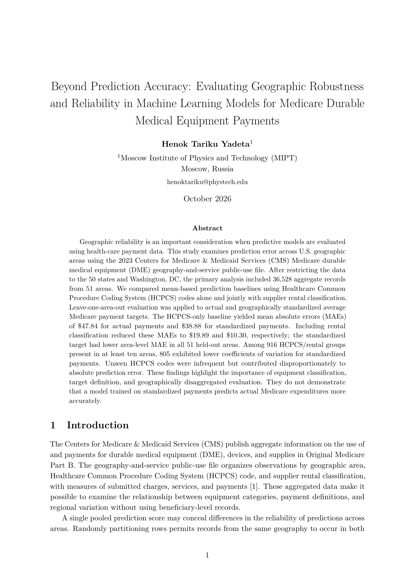

# Beyond Prediction Accuracy

**Evaluating Geographic Robustness and Reliability in Machine Learning Models for Medicare Durable Medical Equipment Payments**

## Research Paper

**Paper title:** *Beyond Prediction Accuracy: Evaluating Geographic Robustness and Reliability in Machine Learning Models for Medicare Durable Medical Equipment Payments*<br>
**Author:** Henok Tariku Yadeta<br>
**Institution:** Moscow Institute of Physics and Technology (MIPT)

[**Read the Full Research Paper (PDF)**](https://github.com/Adam-7th-2/medicare-dme-geographic-robustness/blob/main/paper/main.pdf)

[](paper/main.pdf)

This study evaluates whether Medicare DME payment predictions generalize to geographic areas excluded from training. Using 2023 CMS aggregate records and leave-one-area-out validation, it compares actual and geographically standardized payment targets, HCPCS-only means, and rental-aware means. The analysis highlights geographic evaluation, target definition, rental classification, and unseen-code coverage as important considerations; it does not claim that lower error on standardized payments improves prediction of actual payments.

## Research overview

How reliable are Medicare DME payment predictions in geographic areas excluded entirely from training? The study compares prediction error for actual and geographically standardized average payment targets in CMS 2023 aggregate records. The completed experiments use **interpretable mean-based baselines rather than Random Forests or deep neural networks**.

## Key experimental findings

| Held-out model | Actual-payment MAE | Standardized-payment MAE |
|---|---:|---:|
| HCPCS mean | 47.838395 | 38.878699 |
| HCPCS plus rental mean | 19.894409 | 10.300449 |

Adding rental classification substantially reduced held-out actual-payment MAE. Standardized-target MAE was lower in all 51 tested areas under both paired specifications. Of 916 comparable HCPCS/rental groups, 805 had lower standardized CV. Unseen HCPCS codes generated disproportionately high errors: 137 unseen-code observations had actual MAE 746.996987, compared with 36,391 known-code observations.

Random splits were not consistently more optimistic: geographic MAE exceeded random MAE in 12 of 30 preliminary comparisons. Mean geographic and random MAEs were 47.60 and 49.07; differing test composition limits interpretation. Errors for different payment targets are not interchangeable. A lower standardized-target MAE does not establish a causal improvement in predicting actual Medicare payments. Full values and producing scripts are in [docs/RESULTS_SUMMARY.md](docs/RESULTS_SUMMARY.md).

## Dataset description

The source is the [official CMS catalog](https://data.cms.gov/provider-summary-by-type-of-service/medicare-durable-medical-equipment-devices-supplies/medicare-durable-medical-equipment-devices-supplies-by-geography-and-service): 2023 Medicare Durable Medical Equipment, Devices & Supplies by Geography and Service. The original file has 38,675 rows and 18 columns. Exploratory analyses retain 37,028 State-labeled rows across 60 categories; the primary population contains 36,528 rows, 51 areas (50 states plus DC), and 1,250 HCPCS codes.

The raw input belongs at `data/raw/Medicare_DME_Devices_Supplies_by_Geography_and_Service_2023.csv`; script 07 generates the primary file at `data/processed/medicare_dme_2023_51_areas.csv`. Both CSV files are excluded from Git pending verification of redistribution terms. Download the 2023 file from the CMS catalog and consult [docs/data_provenance.md](docs/data_provenance.md) for filters and SHA-256 hashes. The original download date and precise release revision are unrecorded. These public-use aggregate data can reflect suppression and do not describe individual patients.

## Methodology

The study compares random and geographic evaluation, errors by area and code coverage, within-code geographic variability, and variation between payment targets. Preliminary analyses use the 60-category population: an initial 80/20 split with seed 42, followed by repeated random/group splits over seeds 0–29. Main leave-one-area-out validation trains on 50 areas and holds out the remaining area, repeating across all 51 areas. Every primary row is evaluated once per target.

The global baseline predicts the training mean. HCPCS-only predictions use the training mean for each HCPCS code, falling back to the global mean. Rental-aware predictions use joint HCPCS/rental means, then code means, then the global mean. Actual and standardized targets are predicted separately on matching geographic partitions; all means are learned only from training areas. Metrics include micro/macro MAE, RMSE, NMAE, and worst-area MAE. Descriptive coefficients of variation use sample standard deviations within code/rental groups represented in at least ten areas.

## Repository structure

- `src/`: 13 implemented experiments and five inert script placeholders.
- `paper/`: reviewed `main.pdf`, LaTeX manuscript sources, and active `references_manual.tex` bibliography.
- `results/tables/`: 17 verified CSV outputs; `results/figures/`: three paper figure PDFs.
- `docs/`: data provenance, experiment log, reproduction guide, and verified results summary.
- `data/raw/` and `data/processed/`: local-only inputs excluded from Git pending data-sharing review.
- `.vscode/settings.json`: VS Code Python interpreter and PDFLaTeX-twice recipe.

## Installation and reproducibility instructions

Verified on Windows with Python 3.12.10. From the project directory in PowerShell:

```powershell
py -3.12 -m venv .venv
.\.venv\Scripts\Activate.ps1
python -m pip install -r requirements.txt
```

If activation is unavailable, invoke `.\.venv\Scripts\python.exe` directly. To reproduce the analyses, download the original 2023 CSV from the CMS catalog and save it at the `data/raw/` path listed above. Then run the 13 implemented scripts in numeric order, starting with:

```powershell
python .\src\01_data_audit.py
```

Script 07 regenerates the processed dataset; script 10 must precede figure script 11. The complete PowerShell command sequence is in [docs/REPRODUCIBILITY.md](docs/REPRODUCIBILITY.md), and script/output mappings are in [docs/experiment_log.md](docs/experiment_log.md). Five similarly numbered placeholder files perform no experiment and are excluded from the run sequence. Normal execution overwrites generated outputs, including processed data; preserve finalized artifacts or work in a copy when validating revisions. The 13 experiments were validated in temporary copies; all 17 CSV outputs and the processed dataset reproduced at `rtol=atol=1e-9`. Confirm CMS redistribution terms before sharing either input CSV.

To rebuild the paper, use MiKTeX PDFLaTeX from the project directory:

```powershell
Push-Location .\paper
pdflatex -interaction=nonstopmode -halt-on-error -file-line-error main.tex
pdflatex -interaction=nonstopmode -halt-on-error -file-line-error main.tex
Pop-Location
```

Run PDFLaTeX twice and **do not run BibTeX**; `references_manual.tex` is the active bibliography. Keep `../results/figures` available relative to `paper/`. An isolated two-pass build passed without unresolved references/citations, and the preserved PDF's extracted text matches the rebuild.

## Figures and tables

Script 02 produces `payment_distribution.pdf` (exploratory log-scale payment histogram) and `geographic_coverage.pdf` (top 15 exploratory areas). Script 11 produces `standardization_cv_comparison.pdf` for 916 primary code/rental groups. The five consolidated paper tables cover dataset composition, preliminary baselines, known/unseen code coverage, paired geographic CVs, and prediction errors. Table values match saved outputs at displayed precision; all 17 detailed CSVs are mapped in [docs/experiment_log.md](docs/experiment_log.md).

## References

The active bibliography is [paper/references_manual.tex](paper/references_manual.tex), containing ten cited academic and data references: CMS (2023); Roberts et al. (2017); O'Donnell et al. (2013); Subbaswamy and Saria (2020); Pedregosa et al. (2011); Kohavi (1995); Steyerberg et al. (2010); Arlot and Celisse (2010); Cawley and Talbot (2010); and Varma and Simon (2006). They cover the CMS source data, structured validation, payment standardization, dataset shift, prediction assessment, scikit-learn, and model-selection bias. `paper/references.bib` is retained as legacy bibliography metadata. Citation resolution is verified; publisher-by-publisher metadata verification was not performed.

## Limitations and license notes

One year of aggregate records, suppression, varying service volume, and unmatched preliminary test populations limit inference. Metrics weight rows equally, not beneficiaries or expenditure. NMAE divides MAE by the relevant mean target and is not MAPE. The study did not include a future-year test, geographic uncertainty intervals, flexible-model comparison, or causal standardization experiment. Lower standardized-target error compares different outcomes and does not demonstrate better prediction of actual expenditure.

No project software license or verified dataset redistribution terms were found. No license is implied. The source and processed CMS CSVs remain local and ignored by Git until redistribution terms are verified. Private correspondence and personal records are not part of this repository.
